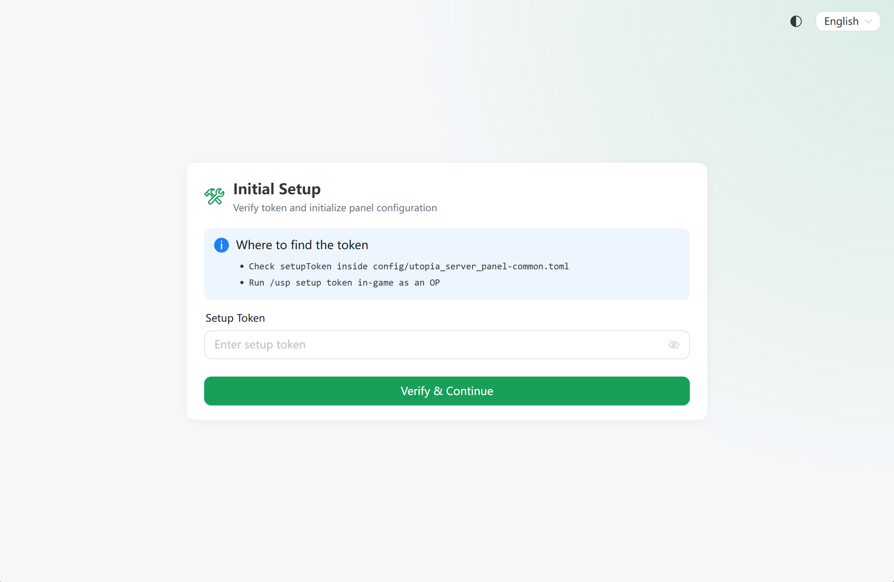
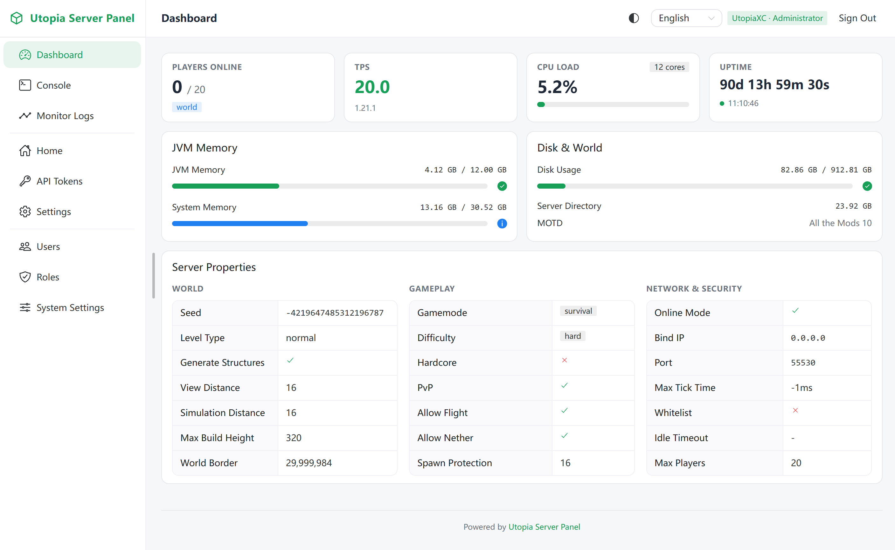
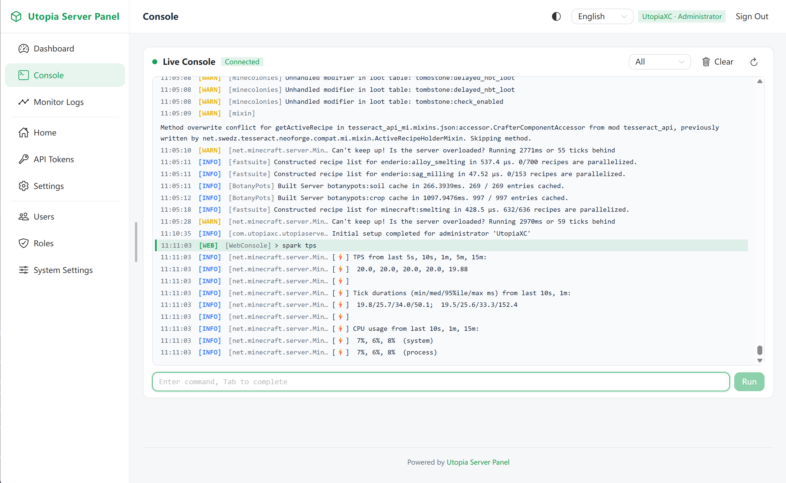
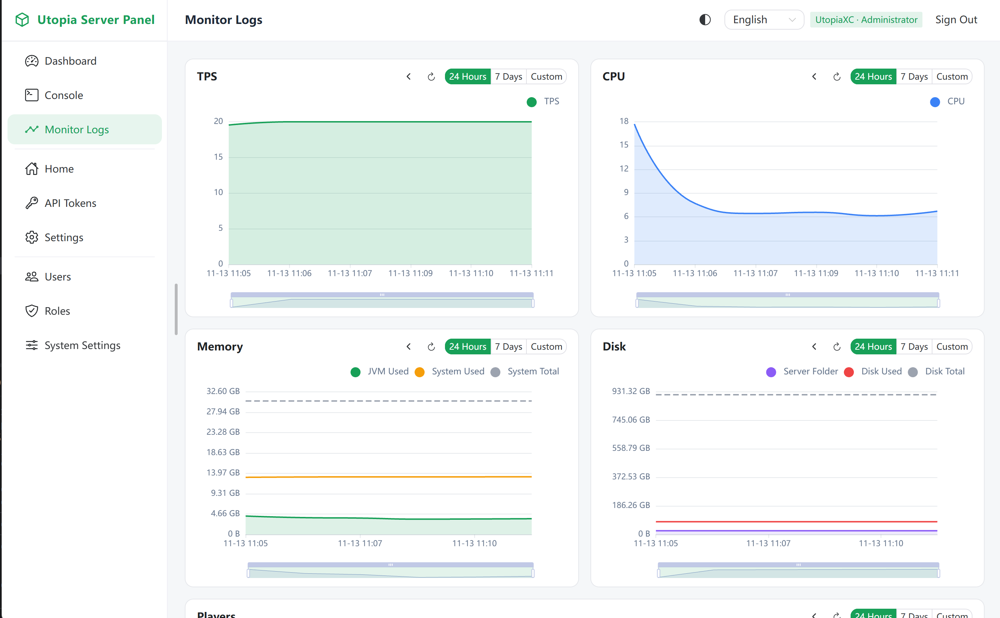

# Utopia Server Panel

> A lightweight, multi-version web management panel mod for Minecraft servers.

**Language**: English | [简体中文](assets/docs/README/README.md)

Utopia Server Panel embeds a self-contained Web UI, real-time console, server monitor, and player-account binding service directly inside Minecraft, supporting Forge, NeoForge, and Fabric from 1.7.10 to 26.3.

## Live Demo
[All The Mod 10 Running On My Server](https://mc-panel.utopiaxc.com/)

## Download
Choose the `.jar` matching your Minecraft version and mod loader from the release build matrix. Every build is a single standalone mod file with no external database or runtime dependencies required.

### CurseForge
[CurseForge: Utopia Server Panel](https://www.curseforge.com/minecraft/mc-mods/utopia-server-panel)

### Modrinth
[Modrinth: Utopia Server Panel](https://modrinth.com/mod/utopia-server-panel)

### Github Release
[Latest Releases](https://github.com/UtopiaXC/UtopiaServerPanel/releases)

## Supported Platforms
**Notice：** ONLY 1.7.10, 1.12.2, 1.16.5, 1.21.1 AND 26.3 HAS DONE LOCAL SMOKE TESTING, IF YOU ARE USING OTHER VERSIONS, PLEASE USE IT CAREFULLY.  

| Platform | Minecraft Versions | Java |
| --- | --- | --- |
| Forge | `1.7.10`, `1.12.2`, `1.16.5` – `26.3` | Java 8+ (1.7.10–1.16.5), Java 17+ (1.18–1.20.4), Java 21+ (1.20.6–1.21.11), Java 25+ (26.x) |
| NeoForge | `1.20.4` – `26.3` | Java 17+ (1.20.4), Java 21+ (1.20.6–1.21.11), Java 25+ (26.x) |
| Fabric | `1.16.5` – `26.3` | Java 8+ (1.16.5), Java 17+ (1.18–1.20.4), Java 21+ (1.20.6–1.21.11), Java 25+ (26.x) |

## Features

- **Multi-User, Role Control & Player Binding**: Multi-user accounts, role-based access control, and multi-character in-game player binding.
- **Web Console**: Real-time browser command execution with Tab completion.
- **Server Logs & Real-Time Monitoring**: Live log streaming alongside TPS, MSPT, system resource, online player, and historical metrics.
- **Web Minimap**: Interactive multi-dimension browser map with live terrain, online players, and waypoints.
- **Whitelist Management**: Online whitelist applications, review workflow, and server whitelist administration.
- **Site Messages & In-Game Chat Sync**: Bidirectional sync between the web chat room and in-game chat, with site messaging.
- **Mod & Server Config Editor**: Browse installed mods and edit `server.properties` and mod configuration files online.

## Quick Start

1. Place the downloaded `.jar` into your server's `mods/` directory and start the server.
2. Check `config/utopia_server_panel.toml` (default port: `55533`) or retrieve the initial setup token in-game with `/usp setup token`.
3. Open `http://<server-ip>:55533` in your browser to finish the administrator setup wizard.

## Commands

- `/usp setup token` — Display the one-time setup token during initial configuration.
- `/usp bind` — Generate a code to bind your Minecraft player to a panel account.
- `/usp unbind` — Unbind your Minecraft player from the panel account.
- `/usp recover password` — Generate a password recovery token in-game.
- `/usp recover 2fa` — Generate a 2FA reset token in-game.

## Contributing

Contributions are welcome.  
AI-assisted pull requests are accepted, provided all changes are reviewed and tested by hand before submission.  
Please follow standard GitHub guidelines when opening issues or pull requests.

## UI/UX Demo

| Initialization | Dashboard |
| --- | --- |
|  |  |  

| Console | Monitor |
| --- | --- |
|  |  |
