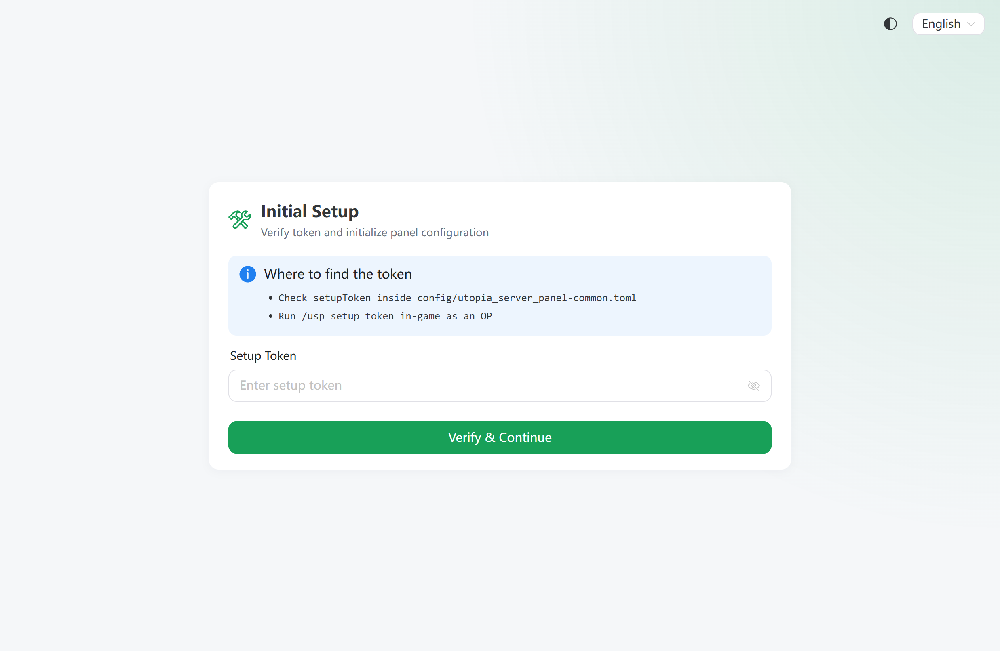
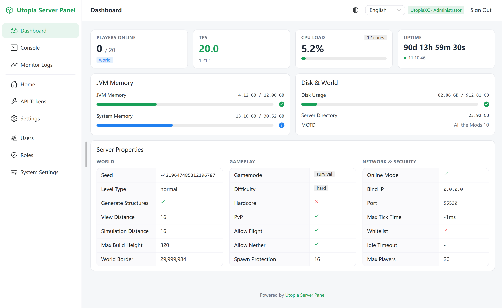
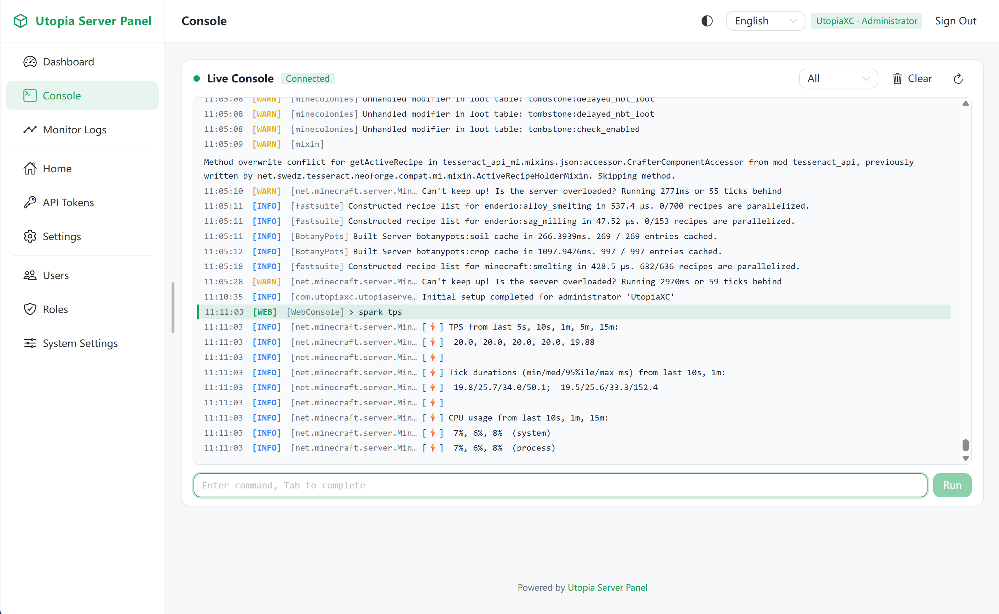
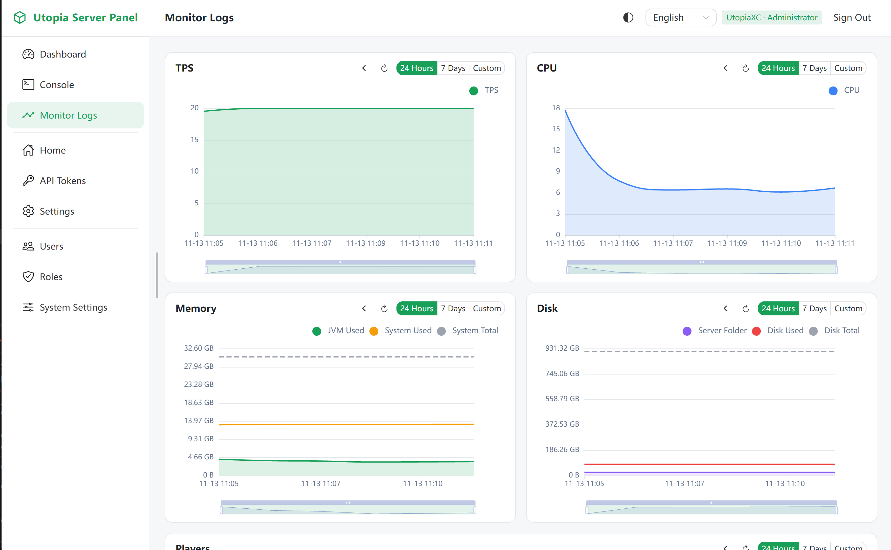

# Utopia Server Panel

> 适用于我的世界多版本、多加载器的轻量级 Web 服务器管理面板模组。

**语言**：[English](../../../README.md) | 简体中文

Utopia Server Panel 将 Web 管理后台、实时控制台、状态监控以及玩家账号绑定系统直接内置于 Minecraft 服务端中，支持从 `1.7.10` 到 `26.3` 的 Forge、NeoForge 与 Fabric。

## 在线演示
[在我的服务器上运行的一个All The Mod 10客户端](https://mc-panel.utopiaxc.com/)

## Download
在对应版本的 Build Matrix 表格中直接点击适合你游戏版本与加载器的 `.jar` 即可下载。单文件开箱即用，无需额外安装数据库或外部运行库。

### CurseForge
推荐。如果显示404或只有更旧的版本，可能最新版本正在审查，如有需要请从Github Release下载。  
[CurseForge: Utopia Server Panel](https://www.curseforge.com/minecraft/mc-mods/utopia-server-panel)  

### Github Release
[Latest Releases](https://github.com/UtopiaXC/UtopiaServerPanel/releases)  

## 兼容矩阵

| 加载器 | 支持的游戏版本 | 运行环境 |
| --- | --- | --- |
| Forge | `1.7.10`、`1.12.2`、`1.16.5` – `26.3` | Java 8+（1.7.10–1.16.5）、Java 17+（1.18–1.20.4）、Java 21+（1.20.6–1.21.11）、Java 25+（26.x） |
| NeoForge | `1.20.4` – `26.3` | Java 17+（1.20.4）、Java 21+（1.20.6–1.21.11）、Java 25+（26.x） |
| Fabric | `1.16.5` – `26.3` | Java 8+（1.16.5）、Java 17+（1.18–1.20.4）、Java 21+（1.20.6–1.21.11）、Java 25+（26.x） |

## 核心功能

- **运行概览与监控**：实时查看 TPS、MSPT、内存、CPU、磁盘及在线玩家，并支持历史监控曲线。
- **实时 Web 控制台**：基于 WebSocket 的日志实时推送、指令执行与 Tab 自动补全。
- **细粒度权限控制**：支持模块级权限矩阵（禁止 / 只读 / 完全）、自定义角色以及 API 访问令牌。
- **账号安全与找回**：支持 JWT 会话、工作量证明验证码、TOTP 两步验证、SMTP 邮件验证与游戏内账号绑定找回。
- **响应式界面**：支持昼夜主题切换与中英文界面切换。

## 快速开始

1. 将下载的 `.jar` 放入服务端 `mods/` 目录并启动服务器。
2. 查看 `config/utopia_server_panel.toml`（默认端口 `55533`），或在游戏内/后台查看初始化令牌 `/usp setup token`。
3. 在浏览器访问 `http://<服务器IP>:55533`，按引导完成管理员初始化配置。

## 游戏内指令

- `/usp setup token` — 获取初始化向导所需的一次性令牌。
- `/usp bind` — 生成用于绑定 Minecraft 角色与面板账号的绑定码。
- `/usp unbind` — 解除当前玩家与面板账号的绑定关系。
- `/usp recover password` — 在游戏内生成面板密码重置令牌。
- `/usp recover 2fa` — 在游戏内生成两步验证重置令牌。

## 社区协作

本项目欢迎贡献代码。  
欢迎提交 AI 辅助编写的代码，但在提交 PR 前请务必经过人工审阅与测试。  
请遵守社区规范提交 Issue 与 Pull Request。

## UI/UX Demo

| 初始化界面 | 面板首页 |
| --- | --- |
|  |  |  

| 命令行 | 性能监控记录 |
| --- | --- |
|  |  |
