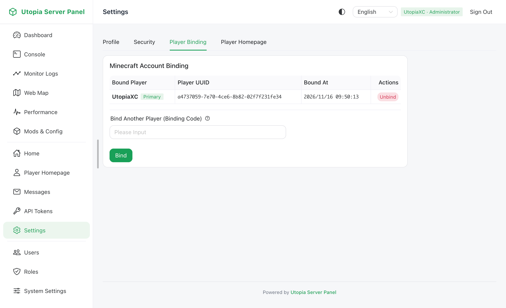

# 玩家绑定

玩家绑定功能用于将 Minecraft 游戏内角色与网页端面板账号建立关联。一个面板账号支持绑定多个游戏角色，并可指定其中一个作为主角色用于头像与昵称展示。

## 绑定流程

1. 进入 Minecraft 服务器，在游戏内聊天框执行指令 `/usp bind`。
2. 服务端会生成一条带有有效期的一次性绑定码并仅向当前玩家展示。
3. 登录网页端面板，在个人绑定页面或引导页输入该绑定码并提交。
4. 绑定成功后，网页端即可读取该游戏角色的 UUID、玩家名、在线状态、所在维度与皮肤纹理。

## 多角色与主角色管理

- 同一个面板账号可以重复通过 `/usp bind` 绑定多个不同的 Minecraft 角色。
- 每个 Minecraft 角色同一时间只能绑定到一个面板账号上，若该角色已被其他账号绑定，需先解除原有绑定。
- 在已绑定角色列表中，可以将任意一个角色设为主角色。主角色将优先作为玩家主页默认展示的皮肤与游戏角色信息。
- 用户可随时在网页端解除绑定，或在游戏内执行 `/usp unbind` 解除当前游戏角色与面板账号的绑定。

## 注册与强制绑定策略

在 **系统设置 -> 面板设置 -> 注册与绑定** 中，管理员可以配置以下联动策略：

| 配置项 | 说明 |
| --- | --- |
| `requireBindingOnRegister` | 开启后，新用户自助注册时必须同时提供有效的 `/usp bind` 绑定码 |
| `forcePlayerBinding` | 开启后，未绑定任何游戏角色的普通用户在登录后会被拦截并引导完成绑定 |
