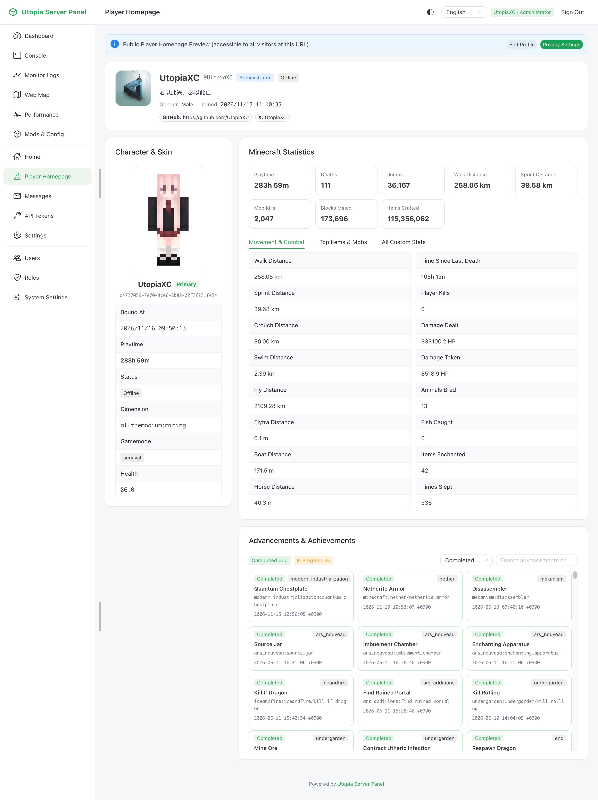

# 玩家主页

Utopia Server Panel 为每位用户提供了可公开访问的个人玩家主页，访问路径为 `/u/用户名`，无需登录即可查看经过隐私过滤后的玩家名片与游戏数据。

## 展示内容

玩家主页整合了网页端个人资料与游戏内实时存档数据，主要包括：

- **基础名片**：用户昵称、用户名、个人头像、性别、生日、个人简介以及社交账号列表。
- **Minecraft 角色与 3D 皮肤**：展示绑定的游戏角色名称、UUID 与实时渲染的 3D 皮肤模型，支持经典与纤细手臂模型自动识别。
- **游戏内统计数据**：当绑定玩家存在存档数据时，可展示在线状态、当前所在维度、坐标位置、生命值、饥饿值、经验等级以及游戏模式。
- **白名单申请入口**：若服务器开启了白名单管理且当前账号允许访客查看，访客也可在页面导航中找到关联入口。

## 个人资料与隐私控制

用户可以在个人设置页面编辑个人资料，并针对公开主页独立配置每一项字段的可见性策略：

| 隐私字段 | 控制范围 |
| --- | --- |
| `showProfile` | 是否公开个人主页本身 |
| `showBio` | 是否显示个人简介 |
| `showGender` | 是否显示性别 |
| `showBirthday` | 是否显示生日 |
| `showEmail` | 是否公开电子邮箱 |
| `showSocialAccounts` | 是否展示绑定的社交账号 |
| `showBoundPlayers` | 是否展示绑定的 Minecraft 角色列表 |
| `showPlayerStats` | 是否展示游戏内属性与在线状态 |
| `showPlayerLocation` | 是否展示玩家当前所在维度与精确坐标 |

若用户关闭了个人主页公开开关，外部访客访问 `/u/用户名` 时将无法查看其详细信息，仅账号本人或具备相应查看权限的管理员可以预览。
