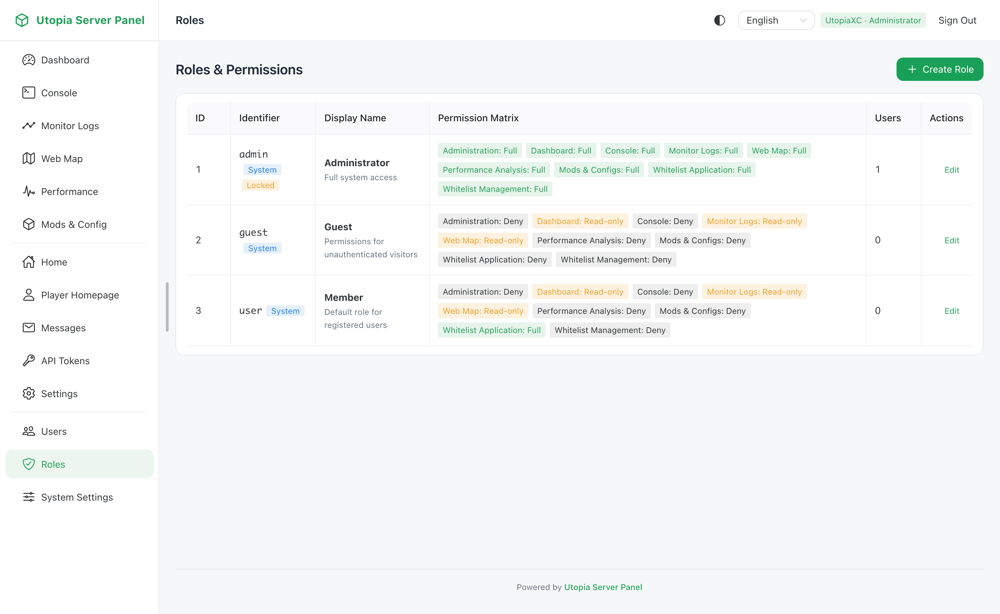

# 角色

Utopia Server Panel 采用基于角色的三级权限模型。每个面板账号都会归属一个角色，未登录的访客则统一使用内置的访客角色进行权限判定。

## 权限等级

系统中的每一项功能模块权限都支持以下三个等级：

| 等级数值 | 等级名称 | 含义 |
| --- | --- | --- |
| `0` | 禁止 `deny` | 无法访问对应接口与页面，侧边栏也会隐藏对应入口 |
| `1` | 只读 `readonly` | 可以查看页面与实时数据，但无法执行写入、修改或控制操作 |
| `2` | 完全控制 `full` | 拥有该模块的完整查看与操作权限 |

## 权限模块列表

目前系统内置以下 9 个权限键：

| 权限键 | 对应模块 | 只读权限范围 | 完全控制权限范围 |
| --- | --- | --- | --- |
| `dashboard` | 看板 | 查看实时状态、TPS、MSPT 与系统资源 | 与只读一致 |
| `terminal` | 控制台 | 实时查看服务端输出日志与历史命令 | 向服务端发送并执行控制台指令 |
| `logs` | 监控日志 | 查询历史性能记录、玩家上下线事件与启停记录 | 与只读一致 |
| `map` | 小地图 | 浏览已启用且允许只读可见的地图图层与标记 | 创建或删除个人路径点，并可使用传送等高级能力 |
| `profiler` | 性能分析 | 查看当前最耗时的区块与维度热点统计 | 在游戏内执行传送至热点位置操作 |
| `mods_config` | 模组与服务器配置 | 浏览已安装模组列表，只读查看配置与 `server.properties` | 编辑保存配置文件、修改 `server.properties` 并触发服务器重启 |
| `whitelist_apply` | 白名单申请 | 访问公开白名单申请页面并查询状态 | 提交白名单申请 |
| `whitelist_manage` | 白名单管理 | 查看白名单申请队列与现有服务器白名单列表 | 审核申请、手动添加或移除白名单成员 |
| `admin` | 系统管理 | 查看用户、角色、系统设置与数据库概览 | 新增或编辑用户与角色、修改系统设置、清理地图缓存等 |

## 内置系统角色

初始化完成后，数据库会自动预置三个系统角色：

| 角色 ID | 标识名称 | 说明 | 默认权限特征 |
| --- | --- | --- | --- |
| `1` | `admin` | 超级管理员 | 不可修改且不可删除，全部权限固定为 `2` |
| `2` | `guest` | 访客 | 控制未登录用户能看到的内容，默认 `dashboard`、`map` 为 `1`，`whitelist_apply` 为 `2`，其余为 `0` |
| `3` | `user` | 普通成员 | 新注册账号的默认角色，默认 `dashboard`、`logs`、`map` 为 `1`，`whitelist_apply` 为 `2`，其余为 `0` |

管理员可以根据服务器运营需要创建自定义角色，例如仅拥有 `whitelist_manage` 和 `terminal` 权限的服管角色。当存在用户正在使用某个自定义角色时，系统会阻止直接删除该角色，需先将对应用户调整至其他角色后再删除。

## 联动设置

- 在 **系统设置 -> 面板设置 -> 注册与绑定** 中，可以指定新注册用户默认分配的角色 ID，即修改 `defaultRegisterRoleId`。
- 在 **系统设置 -> 游戏内联动设置 -> 白名单** 中开启或关闭「允许访客申请白名单」时，系统会自动同步调整 `guest` 角色的 `whitelist_apply` 权限等级。
- 小地图的细粒度图层可见性可以在 **系统设置 -> 面板功能 -> 小地图** 中单独指定需要 `map` 的只读等级还是完全控制等级，详见 [小地图](/features/minimap)。
