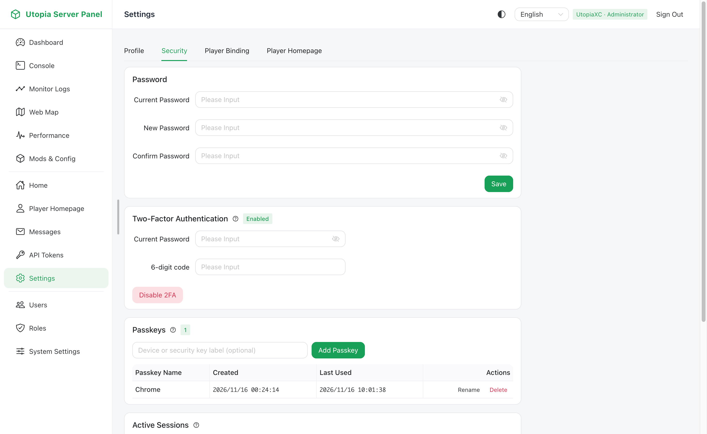

# 安全性

Utopia Server Panel 在账号认证、会话生命周期、二次验证与防暴力破解方面提供了完整的安全机制。

## 登录防护与工作量证明验证码

为防止恶意脚本对登录或注册接口进行暴力请求，面板内置了基于 SHA-256 的工作量证明验证码机制。

- 在 **系统设置 -> 面板设置 -> 安全策略** 中，管理员可将验证码策略设为 `auto`、`always` 或 `off`。
- 在 `auto` 模式下，当某账号触发连续登录失败阈值前或注册等敏感操作时会自动启用验证码挑战。
- 管理员可以调整计算难度系数，范围在 `10000` 至 `1000000` 之间，默认为 `80000`。
- 同一账号连续登录失败次数达到 `maxFailedLogins` 上限后会被自动锁定 `lockoutMinutes` 分钟，默认值分别为 5 次与 15 分钟。

## 两步验证 TOTP

面板支持基于时间的一次性密码 TOTP，兼容 Google Authenticator、Microsoft Authenticator、1Password 等标准验证器应用。

1. 在个人安全设置中点击启用两步验证，系统会生成密钥与二维码。
2. 使用验证器扫描二维码并输入 6 位动态验证码完成确认。
3. 启用后，使用密码登录时需额外输入动态验证码。
4. 管理员可在 **系统设置 -> 面板设置 -> 安全策略** 中开启 `force2fa` 全局强制要求所有账号启用两步验证，也可以针对单个用户单独设置。

如果用户丢失了验证器设备，可通过以下两种方式恢复：

- 已配置 SMTP 邮件服务时，在登录页使用「重置两步验证」通过邮箱验证码重置。
- 已绑定 Minecraft 角色时，在游戏内执行 `/usp recover 2fa` 获取一次性重置令牌。

## 通行密钥 Passkey

面板完整支持 WebAuthn 标准，允许用户绑定指纹、面容 ID 或硬件安全密钥作为通行密钥。

- **多设备管理**：每个账号可绑定多个 Passkey，并支持自定义名称与随时删除。
- **无密码登录**：在登录页可以直接选择使用 Passkey 一键登录，无需输入用户名和密码。
- **作为二次验证因子**：当账号启用了两步验证时，除了输入 TOTP 动态码，也可以直接通过 Passkey 完成二次验证。

::: warning 注意事项
WebAuthn 依赖浏览器的安全上下文。若通过域名对外提供服务，请务必使用 HTTPS 协议，并在 **系统设置 -> 面板设置 -> 系统信息** 中正确填写站点的 `baseUrl`。本地调试使用 `localhost` 或 `127.0.0.1` 时浏览器默认视为安全上下文。
:::

## 会话管理、登录审计与个人访问令牌

- **活跃会话管理**：用户在个人设置中可以查看当前所有活跃登录设备、IP 地址、User-Agent 与最近活跃时间，并可随时吊销任意会话使其立即下线。会话默认有效期为 `7` 天，可在系统安全策略中调整。
- **登录审计记录**：系统会记录最近 20 条登录尝试记录，包括时间、IP、登录方式以及成功或失败状态，便于用户排查异常登录。
- **个人访问令牌**：用户可以在「API 访问令牌」页面创建以 `usp_` 开头的高权限或受限作用域令牌，用于外部脚本与自动化集成，详见 [API 接口文档](/api/)。
