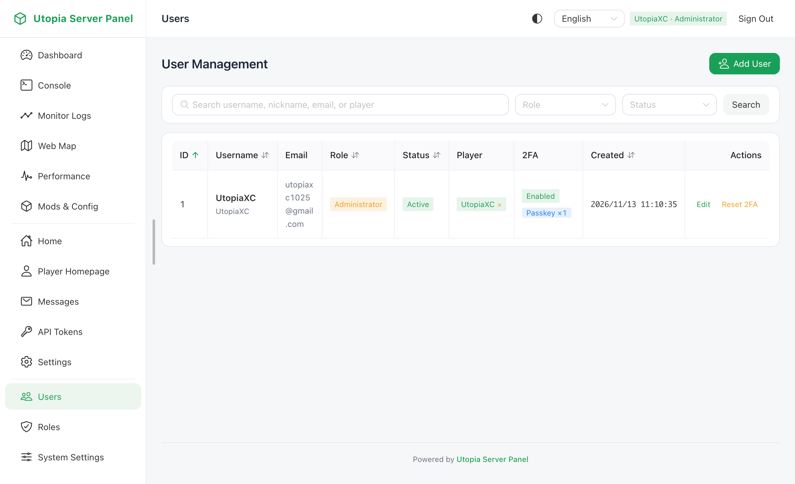

# 用户

拥有 `admin` 权限的管理员可以在用户管理页面查看、创建、编辑或删除面板账号，并对账号状态、密码策略和两步验证进行管理。

## 账号状态

面板用户共有四种状态：

| 状态 | 含义 |
| --- | --- |
| `active` | 正常状态，可正常登录并使用权限范围内的功能 |
| `inactive` | 未激活状态，通常在开启邮箱验证后由新注册用户产生，需通过激活链接激活 |
| `frozen` | 冻结状态，无法登录，已有会话与令牌均会失效 |
| `banned` | 封禁状态，无法登录，所有操作均会被拒绝 |

## 管理员常用操作

1. **创建用户**：管理员可直接指定用户名、昵称、邮箱、初始密码与所属角色，并可勾选是否要求首次登录强制修改密码以及是否强制开启两步验证。
2. **编辑用户**：可修改用户昵称、邮箱、角色分配、账号状态以及两步验证强制策略。
3. **解除玩家绑定**：当玩家更换游戏账号或需要重新绑定时，管理员可在用户列表中直接解除该用户的游戏角色绑定关系。
4. **重置两步验证**：若用户遗失了验证器设备且无法通过游戏内指令找回，管理员可强制重置其 TOTP 两步验证配置。
5. **解锁账号**：当用户连续登录失败次数达到阈值触发自动锁定时，管理员可一键解除锁定状态。
6. **删除用户**：支持删除非当前登录管理员的账号，删除时会自动级联清理该用户的会话、令牌、Passkey 与绑定记录。

## 注册与绑定联动设置

新用户的注册行为与玩家绑定要求由 **系统设置 -> 面板设置 -> 注册与绑定** 控制：

- **允许公开注册**：关闭后登录页不再开放自助注册，仅允许管理员在后台手动创建账号。
- **默认注册角色**：指定自助注册用户初始分配的角色。
- **要求邮箱验证**：开启后新注册账号初始状态为 `inactive`，系统会通过 SMTP 发送激活邮件。该选项要求先配置并启用 SMTP 服务。
- **注册时要求绑定游戏角色**：开启后用户在注册阶段必须填写通过 `/usp bind` 获取的绑定码。
- **强制绑定游戏角色**：开启后已登录但尚未绑定游戏角色的普通用户会被引导至绑定页面完成绑定后才可继续使用面板功能。
