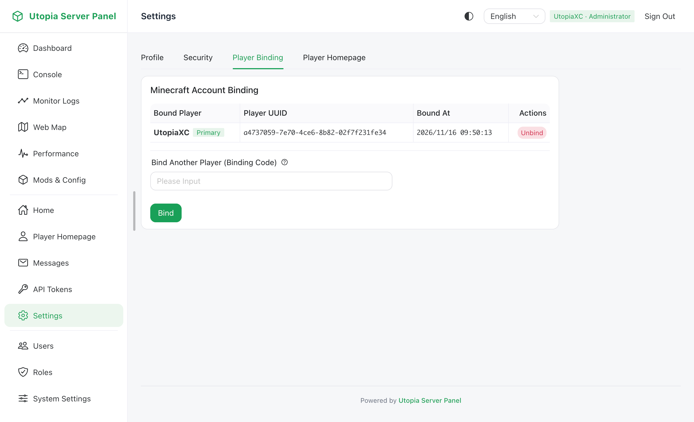

# Player Binding

Player binding links in-game Minecraft characters to web panel accounts. A single panel account can bind multiple Minecraft characters and designate one as the primary character for avatar and profile display.

## Binding Workflow

1. Join the Minecraft server and run `/usp bind` in the in-game chat.
2. The server generates a one-time expiring binding code visible only to that player.
3. Log in to the web panel and submit the binding code on the Player Binding page.
4. Once bound, the panel associates the character's UUID, username, online status, dimension, and skin texture with your account.

## Multi-Character & Primary Player Management

- One panel account can bind multiple Minecraft characters by repeating `/usp bind`.
- Each Minecraft character can only be bound to one panel account at a time.
- Any bound character can be marked as the primary player, which is prioritized on your public player homepage.
- Players can unbind characters from the web panel at any time or run `/usp unbind` in-game.

## Registration & Enforcement Policies

Administrators can configure the following options under **System Settings -> Panel Settings -> Registration & Binding**:

| Setting | Description |
| --- | --- |
| `requireBindingOnRegister` | Requires a valid `/usp bind` code during public user registration |
| `forcePlayerBinding` | Prompts logged-in users without any bound characters to complete binding before using panel features |
