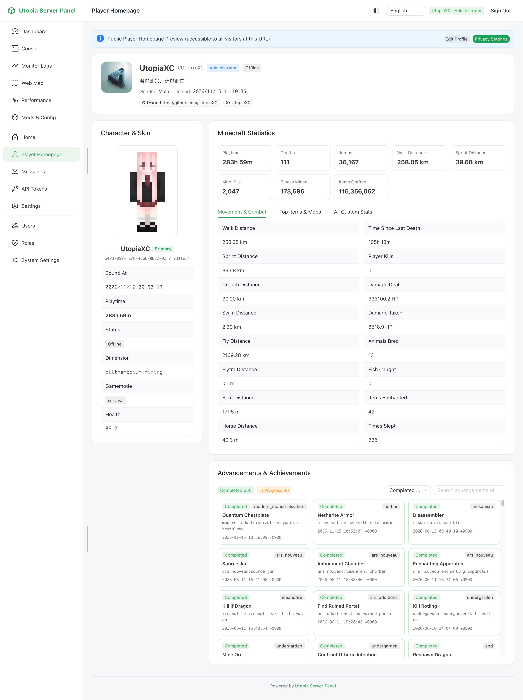

# Player Profile

Utopia Server Panel provides a public player homepage for every user at `/u/username`, allowing visitors to view a privacy-filtered player card and in-game statistics without logging in.

## Displayed Information

The player homepage combines web profile details with live in-game save data:

- **Profile Card**: Nickname, username, avatar, gender, birthday, bio, and linked social accounts.
- **Minecraft Character & 3D Skin**: Displays bound character name, UUID, and an interactive 3D skin canvas with automatic classic and slim arm model detection.
- **In-Game Statistics**: When save data is available for the bound player, displays online status, current dimension, coordinates, health, hunger, experience level, and game mode.
- **Whitelist Shortcut**: When whitelist management is enabled, visitors can also access the whitelist portal from the navigation bar.

## Profile & Privacy Controls

Users can edit their profile in Personal Settings and configure independent visibility toggles for each public profile field:

| Privacy Field | Controlled Scope |
| --- | --- |
| `showProfile` | Whether the public profile page itself is accessible |
| `showBio` | Whether the personal bio is visible |
| `showGender` | Whether gender is visible |
| `showBirthday` | Whether birthday is visible |
| `showEmail` | Whether email address is visible |
| `showSocialAccounts` | Whether linked social accounts are visible |
| `showBoundPlayers` | Whether bound Minecraft characters are visible |
| `showPlayerStats` | Whether in-game stats and online status are visible |
| `showPlayerLocation` | Whether current dimension and exact coordinates are visible |

If a user disables public profile visibility, external visitors navigating to `/u/username` will not see their details, while the account owner and authorized administrators can still preview it.
