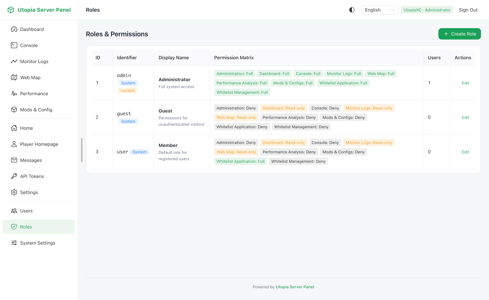

# Roles

Utopia Server Panel uses a role-based three-level permission model. Every panel account belongs to a role, while unauthenticated visitors use the built-in guest role for permission checks.

## Permission Levels

Every module permission in the system supports the following three levels:

| Level | Name | Meaning |
| --- | --- | --- |
| `0` | `deny` | Access to the corresponding API endpoints and pages is blocked, and sidebar entries are hidden |
| `1` | `readonly` | Allows viewing pages and real-time data without write, edit, or control actions |
| `2` | `full` | Grants full view and management access for the module |

## Permission Modules

The system includes 9 built-in permission keys:

| Key | Module | Read-Only Scope | Full Scope |
| --- | --- | --- | --- |
| `dashboard` | Dashboard | View live server status, TPS, MSPT, and system resources | Same as read-only |
| `terminal` | Console | Stream live server console logs and view command history | Execute commands in the server console |
| `logs` | Monitoring Logs | Query historical performance logs, player events, and server lifecycle records | Same as read-only |
| `map` | Web Minimap | View enabled map layers and markers allowed for read-only users | Create or delete personal waypoints and use advanced features such as teleportation |
| `profiler` | Performance Profiler | Inspect top tick-time chunk and dimension hotspot statistics | Teleport in-game to hotspot coordinates |
| `mods_config` | Mods & Server Config | Browse installed mods and view mod configs and `server.properties` in read-only mode | Edit and save mod configs, update `server.properties`, and trigger server restarts |
| `whitelist_apply` | Whitelist Application | Visit the public whitelist application page and check status | Submit whitelist applications |
| `whitelist_manage` | Whitelist Management | View the application queue and current server whitelist entries | Review applications and manually add or remove whitelist entries |
| `admin` | Administration | View users, roles, system settings, and database overview | Create or edit users and roles, modify system settings, and clear map cache |

## Built-in System Roles

After initialization, the database seeds three built-in roles:

| Role ID | Name | Description | Default Permissions |
| --- | --- | --- | --- |
| `1` | `admin` | Administrator | Immutable and cannot be deleted; all permissions are fixed at `2` |
| `2` | `guest` | Guest | Controls visibility for unauthenticated visitors; defaults to `dashboard` and `map` at `1`, `whitelist_apply` at `2`, others `0` |
| `3` | `user` | Member | Default role for newly registered accounts; defaults to `dashboard`, `logs`, and `map` at `1`, `whitelist_apply` at `2`, others `0` |

Administrators can create custom roles tailored to server operations, such as a moderator role with `whitelist_manage` and `terminal` access. If any users are still assigned to a custom role, the system prevents deleting that role until those users are reassigned.

## Related Settings

- Under **System Settings -> Panel Settings -> Registration & Binding**, you can configure `defaultRegisterRoleId` to control which role newly registered users receive.
- Under **System Settings -> In-Game Integration -> Whitelist**, toggling **Allow Guest Whitelist Applications** automatically updates the `whitelist_apply` level on the `guest` role.
- Fine-grained minimap layer visibility can be configured per capability under **System Settings -> Panel Features -> Web Map**, as described in [Web Minimap](/en/features/minimap).
