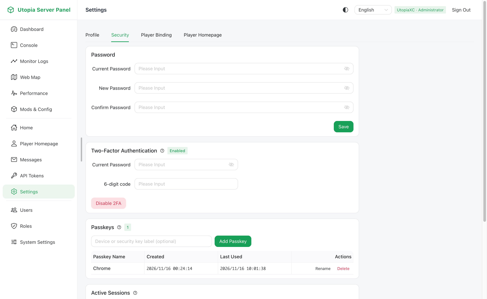

# Security

Utopia Server Panel provides comprehensive security controls across authentication, session lifecycle, multi-factor verification, and brute-force protection.

## Login Protection & Proof-of-Work Captcha

To protect login and registration endpoints against automated brute-force requests, the panel includes a built-in SHA-256 Proof-of-Work captcha system.

- Under **System Settings -> Panel Settings -> Security Policy**, administrators can set the captcha policy to `auto`, `always`, or `off`.
- In `auto` mode, challenges are triggered automatically for sensitive actions such as registration or when failed login attempts accumulate.
- Captcha difficulty is configurable between `10000` and `1000000`, defaulting to `80000`.
- When consecutive failed logins reach `maxFailedLogins`, the account is locked for `lockoutMinutes` minutes. Defaults are 5 attempts and 15 minutes.

## Two-Factor Authentication TOTP

The panel supports standard time-based one-time passwords compatible with Google Authenticator, Microsoft Authenticator, 1Password, and similar apps.

1. Click Enable 2FA in Personal Security Settings to generate a secret key and QR code.
2. Scan the QR code with your authenticator app and enter the 6-digit verification code to confirm.
3. Once enabled, password logins require an additional 6-digit TOTP code.
4. Administrators can enforce `force2fa` globally under **System Settings -> Panel Settings -> Security Policy**, or enable it per user.

If a user loses access to their authenticator device, they can recover via:

- Email reset from the login page when SMTP is configured.
- Running `/usp recover 2fa` in-game if a Minecraft player is bound.

## Passkeys

The panel supports the WebAuthn standard, allowing users to register fingerprints, Face ID, or hardware security keys as passkeys.

- **Multi-Device Management**: Bind multiple passkeys per account with custom names and individual removal.
- **Passwordless Login**: Sign in directly from the login page using a registered passkey without entering a username or password.
- **Second-Factor Verification**: Passkeys can also be used as a second factor when 2FA is enabled.

::: warning Note
WebAuthn requires a browser secure context. When serving over a domain name, make sure HTTPS is enabled and configure `baseUrl` accurately under **System Settings -> Panel Settings -> System Info**. Local access via `localhost` or `127.0.0.1` is treated as a secure context by browsers.
:::

## Sessions, Login History & Personal Access Tokens

- **Active Sessions**: View all active login devices, IP addresses, user agents, and last-seen timestamps in Personal Settings, and revoke any session immediately. Default session lifetime is `7` days.
- **Login Audit History**: Tracks the latest 20 login attempts with timestamps, IPs, methods, and success or failure outcomes.
- **Personal API Access Tokens**: Create `usp_` prefixed tokens with full or scoped permissions for scripts and external integrations. See [API Reference](/en/api/).
