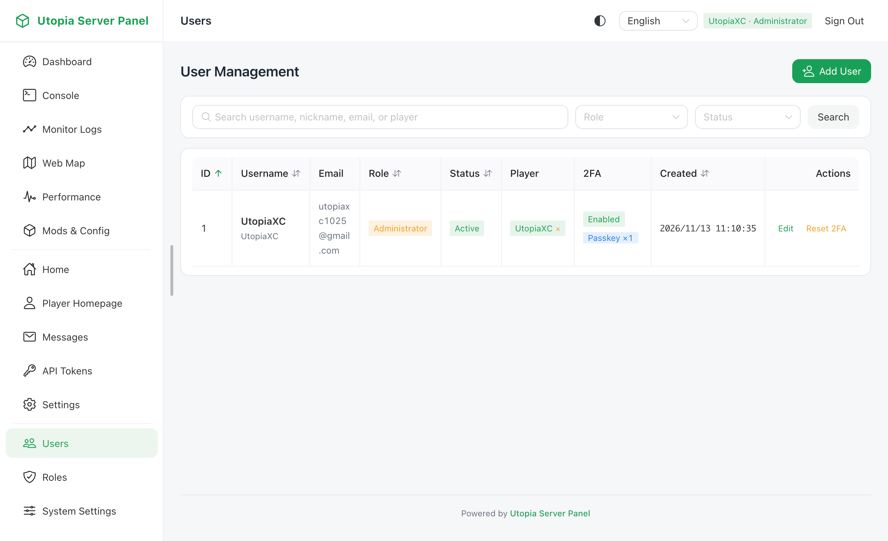

# Users

Administrators with `admin` permission can view, create, edit, or delete panel accounts, and manage account status, password policies, and two-factor authentication.

## Account Statuses

Each panel user account has one of four statuses:

| Status | Meaning |
| --- | --- |
| `active` | Normal state allowing login and access within role permissions |
| `inactive` | Unactivated state, typically created when email verification is enabled; requires activation via email link |
| `frozen` | Frozen state; login is blocked and existing sessions and tokens are rejected |
| `banned` | Banned state; login is blocked and all operations are denied |

## Administrative Actions

1. **Create User**: Specify username, nickname, email, initial password, and role, with options to require password change on first login or enforce 2FA.
2. **Edit User**: Update nickname, email, assigned role, account status, and individual 2FA enforcement.
3. **Unbind Player**: Directly unbind a user's linked Minecraft player accounts when needed.
4. **Reset 2FA**: Force-reset a user's TOTP two-factor authentication if they lost their authenticator device and cannot use in-game recovery.
5. **Unlock Account**: Clear automatic login lockouts caused by repeated failed login attempts.
6. **Delete User**: Remove accounts other than the currently logged-in administrator, cascading cleanup of sessions, tokens, passkeys, and player bindings.

## Registration & Binding Integration

New user registration and player binding policies are controlled in **System Settings -> Panel Settings -> Registration & Binding**:

- **Allow Public Registration**: When disabled, self-registration is hidden from the login page and only administrators can create accounts.
- **Default Registration Role**: Sets the initial role assigned to self-registered users.
- **Require Email Verification**: Newly registered accounts start as `inactive` and receive an activation email via SMTP. Requires SMTP to be configured and enabled first.
- **Require Player Binding on Register**: Requires users to provide a valid `/usp bind` code during registration.
- **Force Player Binding**: Redirects logged-in regular users who have not bound a Minecraft player to the binding page before accessing other panel features.
