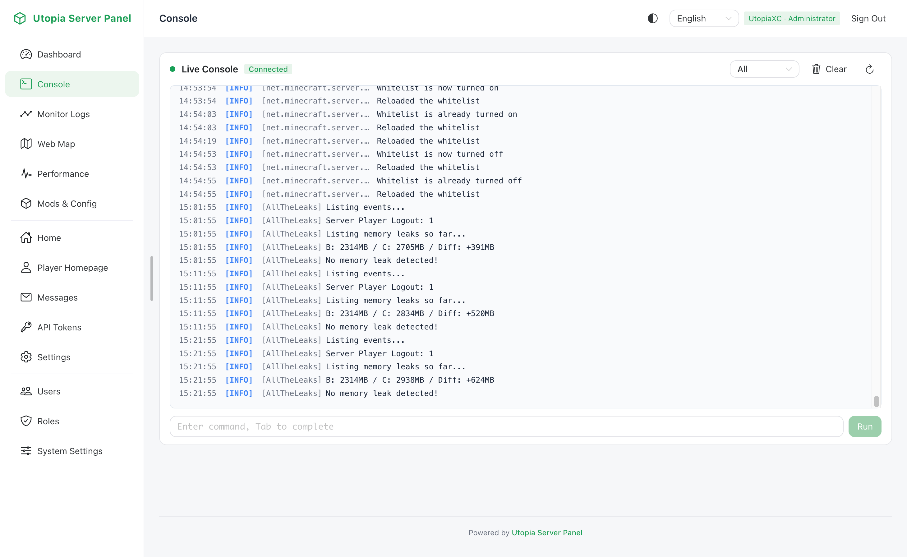

# Console

The Console provides a browser-based terminal mirroring the native Minecraft server console, featuring live log streaming, Tab completion, and command history.

## Permission Requirements

- **Read-Only `terminal:1`**: Streams live server logs over WebSocket, loads buffered log history and executed command history, and supports Tab completion queries.
- **Full Control `terminal:2`**: Allows sending and executing commands directly on the server.

## Core Capabilities

1. **Live Log Stream**: New server log entries are pushed in real time over WebSocket with level-based colorization.
2. **Tab Completion**: Press Tab or request completions after typing a command prefix to fetch matching commands and arguments from the game adapter dispatcher.
3. **Command History**: Cycle through previously executed commands using the Up and Down arrow keys.

## Related Settings

Log buffer capacity and capture threshold are configured in `config/utopia_server_panel.toml`:

| Option | Default | Description |
| --- | --- | --- |
| `maxLogLines` | `1000` | Maximum number of log lines retained in the console buffer, from `100` to `100000` |
| `minLogLevel` | `INFO` | Minimum log level captured and streamed to the web console: `OFF`, `FATAL`, `ERROR`, `WARN`, `INFO`, `DEBUG`, or `TRACE` |

Restart the server or reload configuration after modifying these values.
