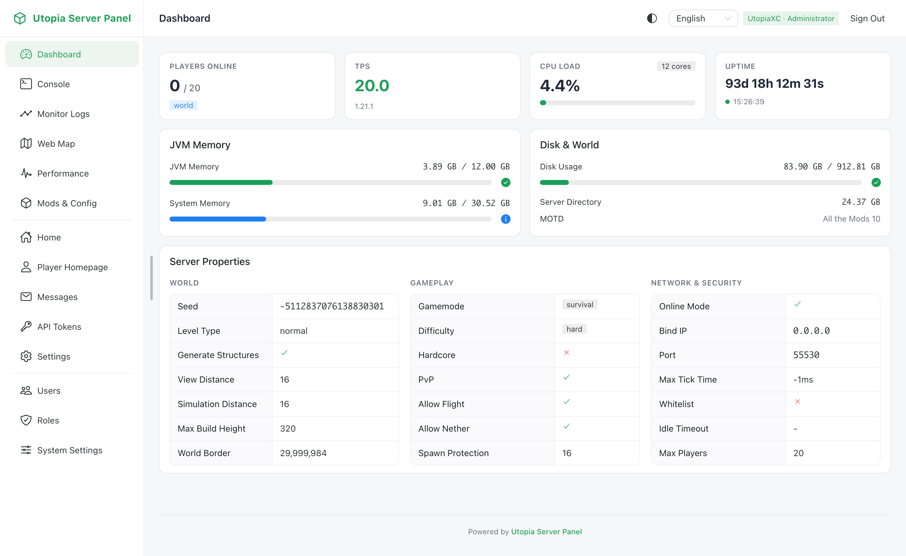

# Dashboard

The Dashboard is the primary view of the panel and requires at least read-only `dashboard:1` permission. It receives incremental status updates over WebSocket to display real-time server health and online player activity.

## Displayed Metrics

The Dashboard includes the following live status cards:

- **Server Overview**: Displays running state, Minecraft version, mod loader and version, world name, MOTD, online player count versus capacity, and uptime.
- **Game Performance**: Streams live TPS and MSPT figures so you can spot main-thread lag immediately.
- **Hardware & JVM Resources**: Displays CPU usage, JVM heap and system memory consumption, disk usage, and system load.
- **Online Players**: Lists currently connected players with latency and links to their public player profiles when bound.
- **Server Lifecycle Card**: Shows the current run start time and recent start/stop history.

## Related Settings

- Status broadcast frequency is controlled by `broadcastInterval` in `config/utopia_server_panel.toml`, defaulting to `3000` ms.
- Historical monitoring charts and player name visibility are governed by `monitorEnabled` and `monitorShowPlayerNames` under **System Settings -> Panel Features -> Monitoring**. See [Panel Settings](/en/settings/panel).
- To allow unauthenticated visitors to view server status on the landing page, ensure the `guest` role has `dashboard` set to level `1`.
