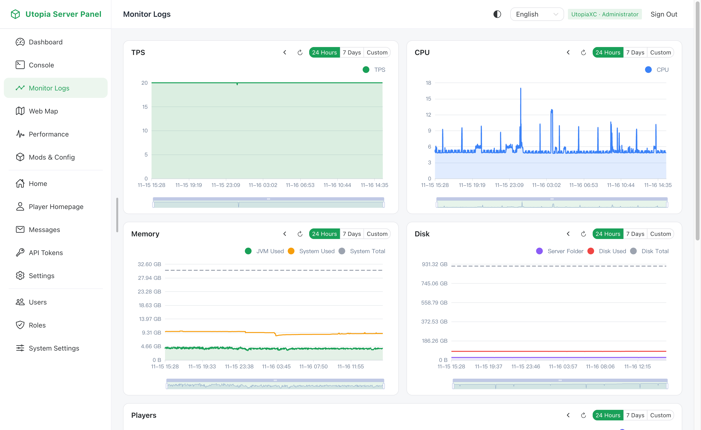

# Monitoring Logs

Monitoring Logs persist long-term server performance metrics, player join/leave events, and server start/stop lifecycle records. Access requires `logs:1` or higher.

## Recorded Data Types

Metrics are periodically written to the SQLite database of the active save:

1. **Performance Samples**: Records TPS, MSPT, CPU usage, memory usage, and online player count at fixed intervals for time-range queries and historical charts.
2. **Player Events**: Logs player join and leave timestamps, player names, and event types.
3. **Server Lifecycle Records**: Tracks startup time, normal shutdown vs unexpected stop status, and session duration.

## Related Settings

Collection and display behavior can be tuned under **System Settings -> Panel Features -> Monitoring**:

| Option | Default | Description |
| --- | --- | --- |
| `monitorEnabled` | `true` | Enables background performance sampling and persistence |
| `monitorInterval` | `60` | Sampling interval in seconds, from `10` to `3600` |
| `monitorRetentionDays` | `30` | Number of days to retain historical records before automatic pruning, from `1` to `3650` |
| `monitorShowPlayerNames` | `true` | Whether player names are shown in monitoring logs and statistics |
