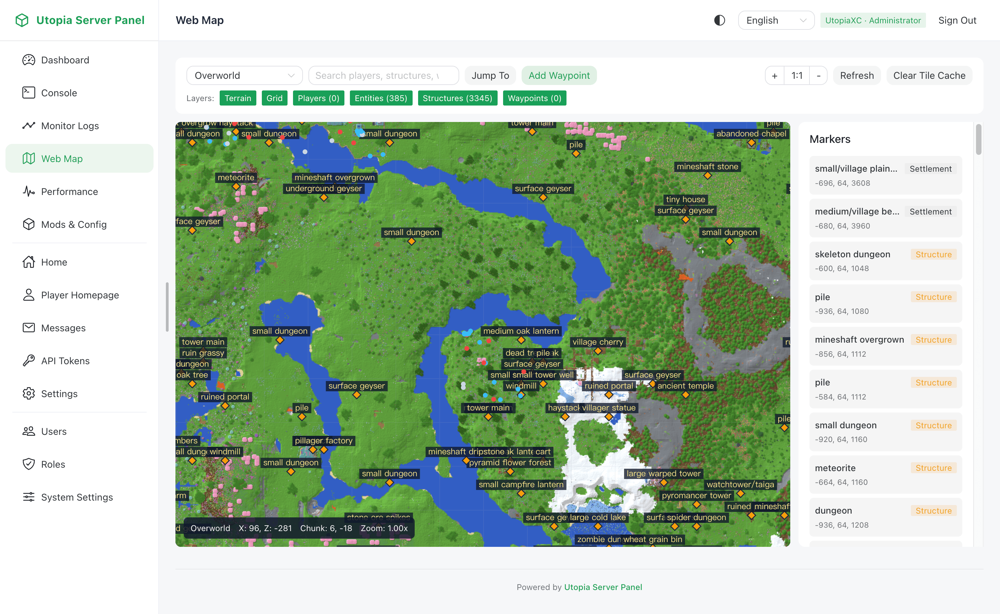

# Web Minimap

The Web Minimap lets administrators and players explore a live, multi-dimension terrain map in the browser, complete with online player markers, entities, and custom waypoints.

## Core Capabilities

- **Multi-Dimension Support**: Automatically discovers Overworld, Nether, End, and modded dimensions with independent pan and zoom.
- **Flexible Render Modes**: Supports live chunk rendering, offline `.mca` region file rendering for unloaded areas, or a hybrid mode.
- **Real-Time Overlays**: Toggle chunk grids, coordinate rulers, water depth shading, height shading, biome tinting, online players, hostile mobs, passive mobs, dropped items and entities, and structures.
- **Nether Ceiling View**: Supports rendering terrain beneath the Nether bedrock ceiling.
- **Waypoints & Map Teleport**: Users with `map:2` can create and delete waypoints, and click-to-teleport moves their bound in-game player to the selected coordinates when enabled.

## Related Settings

All minimap performance parameters and per-layer visibility rules are configured under **System Settings -> Panel Features -> Web Map**.

### Rendering & Cache Options

| Option | Default | Description |
| --- | --- | --- |
| `mapEnabled` | `true` | Master toggle for the Web Minimap |
| `mapRenderMode` | `hybrid` | Render mode: `hybrid`, `live` for loaded chunks only, or `mca` for region files only |
| `mapMaxChunksPerTick` | `2` | Maximum chunks scanned per server tick, from `1` to `16` |
| `mapCacheMaxMb` | `512` | Disk tile cache limit in MB, from `32` to `16384`, stored under `utopia_server_panel/map_cache` in the active world directory |

Administrators with `admin:2` can also clear the map cache or reset map health status.

### Per-Layer Permission Mapping

Each of the 14 minimap capabilities can be independently restricted to `readonly` or `full` under the `map` permission:

| Capability | Default Level | Description |
| --- | --- | --- |
| `mapVisTerrain` | `readonly` | Base terrain tiles |
| `mapVisNetherCeiling` | `readonly` | Nether sub-ceiling terrain rendering |
| `mapVisGrid` | `readonly` | Chunk grid overlay |
| `mapVisCoordinates` | `readonly` | Hover coordinate display |
| `mapVisWaterDepth` | `readonly` | Water depth shading |
| `mapVisHeightShading` | `readonly` | Elevation height shading |
| `mapVisBiomeTint` | `readonly` | Biome color tinting |
| `mapVisPlayers` | `readonly` | Live online player markers |
| `mapVisWaypoints` | `readonly` | Waypoint markers |
| `mapVisMobsHostile` | `full` | Live hostile mob markers |
| `mapVisMobsPassive` | `full` | Live passive mob markers |
| `mapVisEntities` | `full` | Item and other entity markers |
| `mapVisStructures` | `full` | Structure markers |
| `mapVisTeleport` | `full` | Click-to-teleport bound player |
