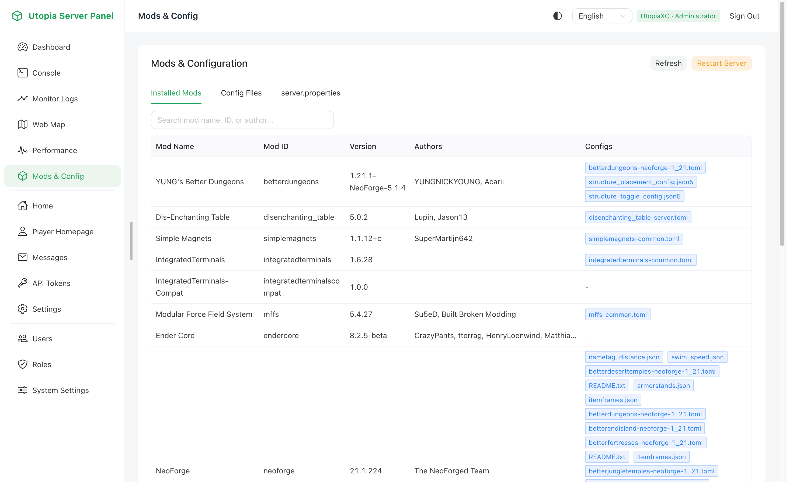

# Mods & Server Config

The Mods & Server Config module lets you inspect installed mods and view or edit `server.properties` and mod configuration files directly from the browser.

## Overview

- **Installed Mods Overview**: Lists every loaded mod's display name, mod ID, version, and description.
- **Mod Config Editor**: Scans text configuration files such as `.toml`, `.json`, `.properties`, and `.cfg` inside `config/` and provides an online editor to modify and save changes.
- **server.properties Editor**: View and edit core server properties including port, game mode, view distance, difficulty, and MOTD.
- **One-Click Restart**: Trigger a server restart directly from the page after updating critical configuration files.

## Permission Control

| Requirement | Allowed Action |
| --- | --- |
| `mods_config:1` | Read-only access to installed mods, `config/` files, and `server.properties` |
| `mods_config:2` | Edit and save mod configs, update `server.properties`, and trigger server restarts |

## Related Settings

The exact behavior of the Restart Server button is controlled under **System Settings -> In-Game Integration -> Server Restart**. See [In-Game Integration](/en/settings/ingame):

- `serverRestartCommand`: Command sent to the server when restarting; defaults to `stop` when left empty so an external supervisor can restart the process.
- `serverRestartHint`: Confirmation hint shown to administrators before restarting, such as reminders for Docker or systemd setups.
