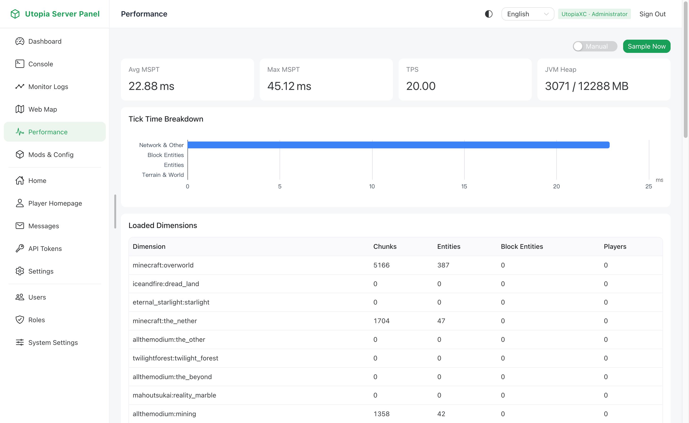

# Performance Profiler

The Performance Profiler helps identify which dimensions and chunks are causing TPS drops or elevated MSPT. Access requires `profiler` permission.

## Features

- **Dimension Breakdown**: Summarizes average tick time, share percentage, loaded chunk count, and entity count per dimension.
- **Chunk Hotspots**: Ranks the heaviest chunks by coordinates, dimension, entity count, block entity count, and estimated tick time to pinpoint lag sources such as mob farms or high-frequency redstone.
- **One-Click Teleportation**: Administrators with `profiler:2` full permission and a bound Minecraft character can teleport directly to a hotspot chunk in-game for inspection.

## Permission Mapping

| Requirement | Allowed Action |
| --- | --- |
| `profiler:1` | Fetch live hotspot snapshots via `/api/profiler/snapshot` |
| `profiler:2` | Teleport in-game to hotspot coordinates via `/api/profiler/teleport` |
