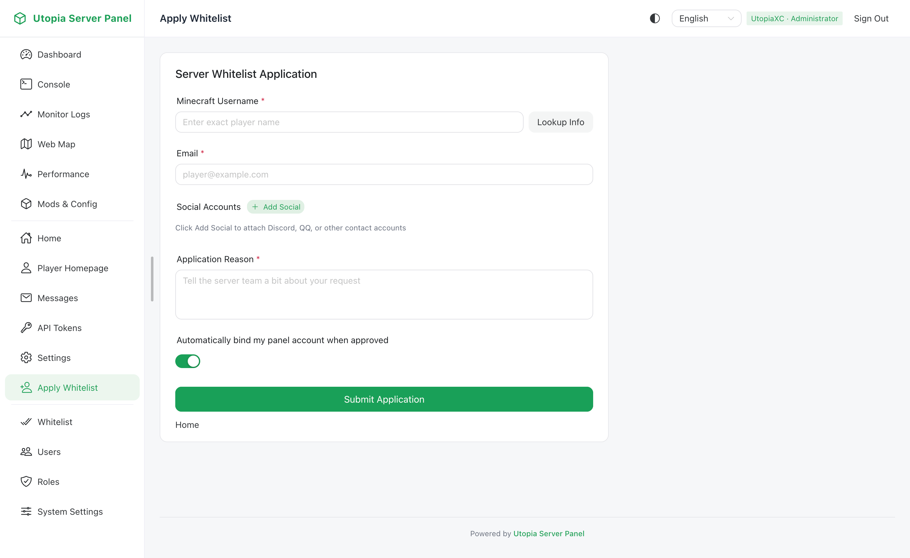
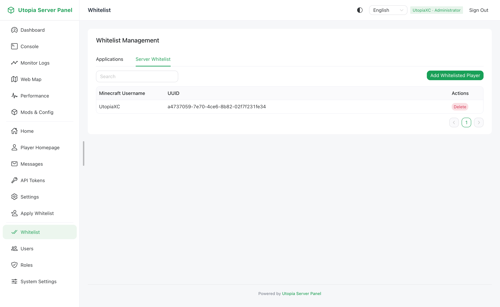

# Whitelist Management

Utopia Server Panel provides an end-to-end whitelist workflow from public applications to admin review and automatic synchronization with the Minecraft server whitelist.

## Public Application Workflow

When whitelist management is enabled, players can visit the public whitelist page to apply:

1. Enter a Minecraft username to validate and inspect current whitelist status.
2. Provide an application reason or introduction, along with any required social platform handles if configured by the administrator.
3. Submit the application to the pending queue and check review progress on the same page.

## Admin Review & Management

Administrators with `whitelist_manage` permission can manage applications and entries:

- **Review Queue**: With `whitelist_manage:2`, approve or reject pending applications with optional review notes. Approved players are automatically added to the native Minecraft server whitelist.
- **Manual Entry Management**: View current server whitelist entries and add or remove players manually.

## Related Settings

All whitelist options and anti-abuse limits live under **System Settings -> In-Game Integration -> Whitelist**:

| Option | Default | Description |
| --- | --- | --- |
| `serverWhitelistEnabled` | Synced with server | Directly toggles the native Minecraft `white-list` setting |
| `whitelistManagementEnabled` | `false` | Enables the panel application and review workflow; automatically disabled if native whitelist is turned off |
| `whitelistAllowGuest` | `true` | Allows unauthenticated guests to submit applications by updating `guest` role `whitelist_apply` permission |
| `whitelistApplyCooldownSec` | `60` | Per-IP cooldown in seconds between applications, from `0` to `86400` |
| `whitelistMaxPendingPerIp` | `5` | Maximum concurrent pending applications per IP, from `1` to `50` |
| `whitelistSendEmail` | `false` | Sends email notifications on approval or rejection; requires SMTP to be enabled and configured |
| `whitelistSocialRequired` | `false` | Requires applicants to provide social platform handles |
| `whitelistRequiredSocialPlatforms` | `[]` | List of required social platform names when social handles are mandatory |
