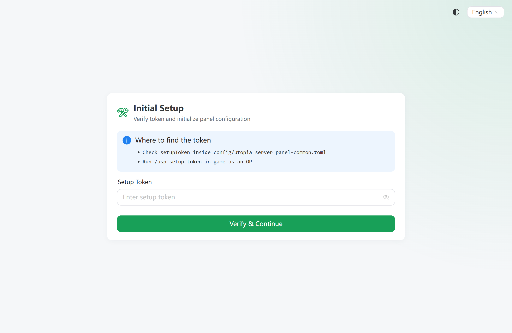

# Getting Started

Utopia Server Panel is a web management panel loaded as a Minecraft mod, so you only need to place the `.jar` file matching your mod loader and Minecraft version into your `mods/` folder.

## Installation & Setup

1. Download the `.jar` matching your Minecraft version and mod loader from [GitHub Releases](https://github.com/UtopiaXC/UtopiaServerPanel/releases), [CurseForge](https://www.curseforge.com/minecraft/mc-mods/utopia-server-panel), or [Modrinth](https://modrinth.com/mod/utopia-server-panel).
2. Place the `.jar` into the `mods/` directory of your server or local game instance and start the server.
3. Check the `setupToken` in `config/utopia_server_panel.toml`, or run `/usp setup token` in-game / in the server console to retrieve the initial setup token.
4. Optional: You can change the web panel port in `config/utopia_server_panel.toml` if needed (default: `55533`). Restart the Minecraft server after making changes.
5. Open `http://<server-ip>:55533` in your browser to finish the administrator setup wizard.

Note: If you use a launcher that can install mods directly from CurseForge or Modrinth (such as HMCL), you can install this mod directly inside the launcher.

## Supported Platforms

::: warning Notice
Only `1.7.10`, `1.12.2`, `1.16.5`, `1.21.1` and `26.3` have done local smoke testing. If you are using other versions, please use it carefully.
:::

| Platform | Minecraft Versions | Java |
| --- | --- | --- |
| Forge | `1.7.10`, `1.12.2`, `1.16.5` – `26.3` | Java 8+ (1.7.10–1.16.5), Java 17+ (1.18–1.20.4), Java 21+ (1.20.6–1.21.11), Java 25+ (26.x) |
| NeoForge | `1.20.4` – `26.3` | Java 17+ (1.20.4), Java 21+ (1.20.6–1.21.11), Java 25+ (26.x) |
| Fabric | `1.16.5` – `26.3` | Java 8+ (1.16.5), Java 17+ (1.18–1.20.4), Java 21+ (1.20.6–1.21.11), Java 25+ (26.x) |
