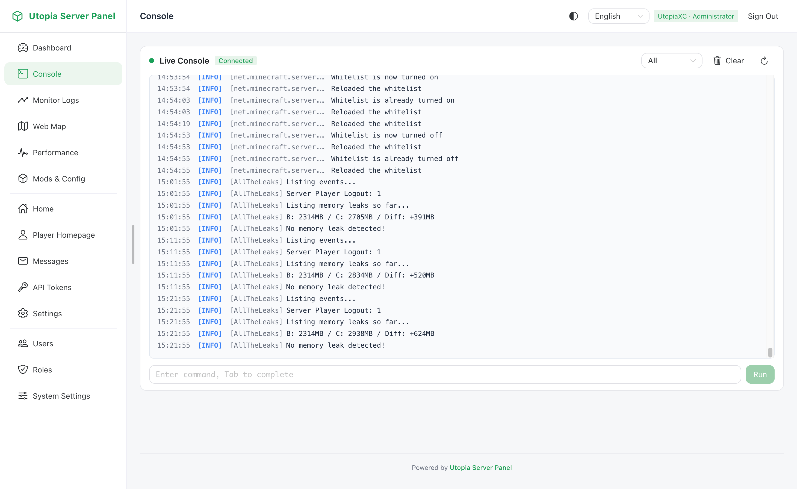

# 控制台

控制台提供了与 Minecraft 服务端原版命令行一致的网页端交互体验，支持实时日志流、指令自动补全与历史指令回溯。

## 权限要求

- **只读权限 `terminal:1`**：连接 WebSocket 后可实时接收服务端新增日志，查看缓冲区内的历史日志与已执行过的指令历史，并可请求指令补全列表。
- **完全控制权限 `terminal:2`**：可以在输入框中向服务端发送并执行任意控制台指令。

## 核心能力

1. **实时日志流**：服务端日志产生时会通过 WebSocket 实时推送到浏览器终端，支持按日志级别着色展示与快速滚动定位。
2. **Tab 自动补全**：输入指令前缀后按 Tab 键或触发补全请求，面板会调用底层游戏适配器的指令分发器返回匹配的候选指令与参数提示。
3. **历史指令**：支持通过上下方向键切换近期发送过的控制台指令，提升重复运维效率。

## 联动设置

控制台日志缓冲区与捕获级别由服务端配置文件 `config/utopia_server_panel.toml` 控制：

| 配置项 | 默认值 | 说明 |
| --- | --- | --- |
| `maxLogLines` | `1000` | 控制台内存缓冲区保留的最大日志行数，范围 `100` 至 `100000` |
| `minLogLevel` | `INFO` | 捕获并推送到网页控制台的最低日志级别，支持 `OFF`、`FATAL`、`ERROR`、`WARN`、`INFO`、`DEBUG`、`TRACE` |

修改上述配置后需重启服务端或重载配置使其生效。
