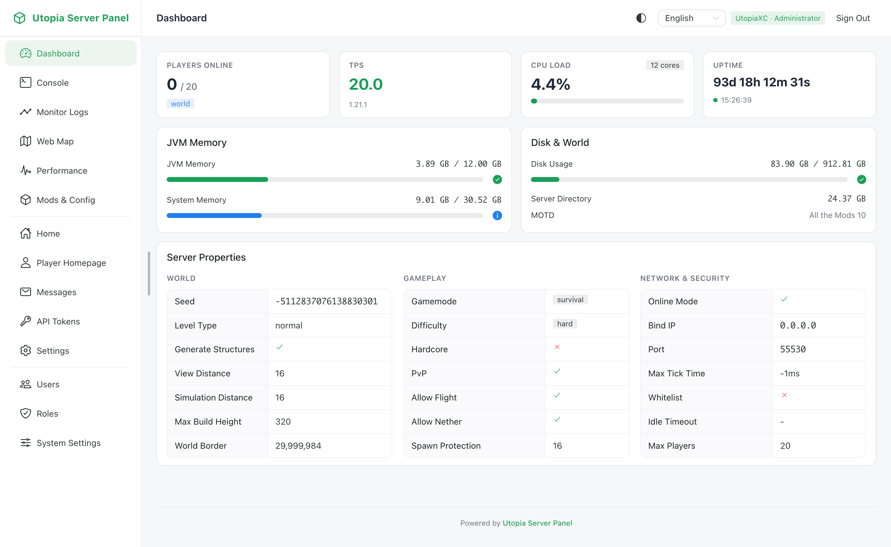

# 看板

看板是面板的主视图，需要 `dashboard` 至少为只读等级 `1` 才可访问。它通过 WebSocket 接收服务端定时推送的增量状态数据，用于实时展示服务器运行健康度与在线玩家情况。

## 展示指标

看板主要包含以下实时信息卡片：

- **服务器基础状态**：展示服务端运行状态、Minecraft 版本、模组加载器与版本、世界名称、MOTD、在线人数与最大人数上限以及服务端累计运行时长。
- **游戏性能指标**：实时显示服务端 TPS 与 MSPT 数值及状态趋势，帮助快速判断主线程是否存在卡顿。
- **硬件与 JVM 资源**：实时展示 CPU 占用率、JVM 堆内存与系统物理内存使用情况、磁盘空间占用以及网络吞吐或系统负载信息。
- **在线玩家列表**：显示当前在线玩家名称与延迟等状态；若已绑定玩家主页，可联动查看对应玩家名片。
- **服务器启停生命周期卡片**：展示当前运行周期的启动时间与历史启停概览。

## 联动设置

- 看板推送频率由 `config/utopia_server_panel.toml` 中的 `broadcastInterval` 控制，默认每 `3000` 毫秒广播一次状态增量。
- 历史监控曲线与是否向普通用户展示玩家名称，受 **系统设置 -> 面板功能 -> 服务器监控** 中的 `monitorEnabled` 与 `monitorShowPlayerNames` 控制，详见 [面板设置](/settings/panel)。
- 如果希望未登录访客也能直接打开面板首页查看服务器在线状态，需确保 `guest` 角色的 `dashboard` 权限等级为 `1`。
