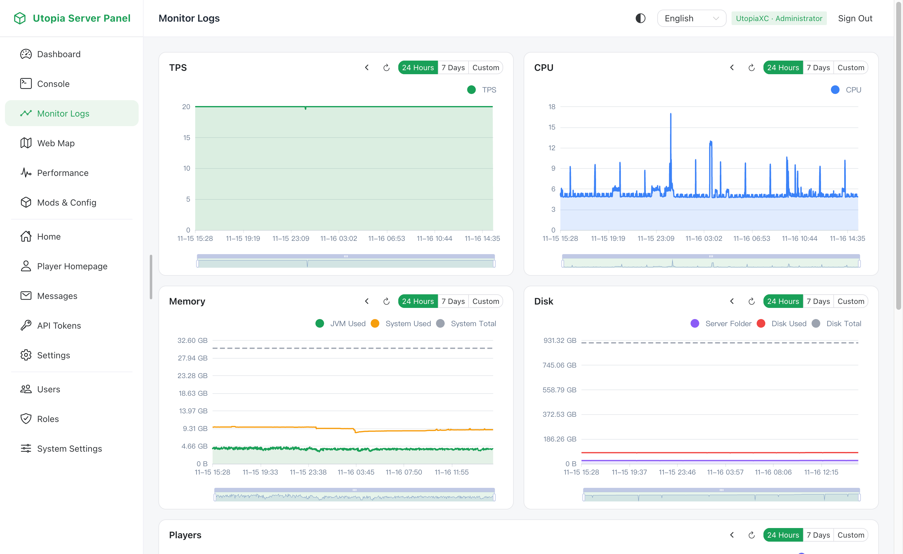

# 监控日志

监控日志用于长期持久化记录并回溯服务器性能走势、玩家上下线活动以及服务端启停历史，需要 `logs` 权限等级 `1` 及以上才可访问。

## 三类持久化日志

面板会将监控数据定期写入当前存档对应的 SQLite 数据库中：

1. **性能采样日志**：按固定采样间隔记录 TPS、MSPT、CPU 占用、内存占用与当前在线人数，支持按时间范围查询并绘制历史折线图。
2. **玩家上下线事件**：记录玩家加入与退出服务器的时间戳、玩家名及事件类型。
3. **服务器生命周期日志**：记录每次服务器启动时间、正常关闭或异常中断状态以及单次运行时长，支持分页与时间区间查询。

## 联动设置

监控采集与展示行为可在 **系统设置 -> 面板功能 -> 服务器监控** 中进行配置：

| 配置项 | 默认值 | 说明 |
| --- | --- | --- |
| `monitorEnabled` | `true` | 是否开启后台定时性能采样与日志落库 |
| `monitorInterval` | `60` | 性能采样间隔，单位为秒，范围 `10` 至 `3600` |
| `monitorRetentionDays` | `30` | 监控历史数据保留天数，范围 `1` 至 `3650`，超期数据会自动清理 |
| `monitorShowPlayerNames` | `true` | 是否在监控日志与统计视图中展示具体玩家名称 |
