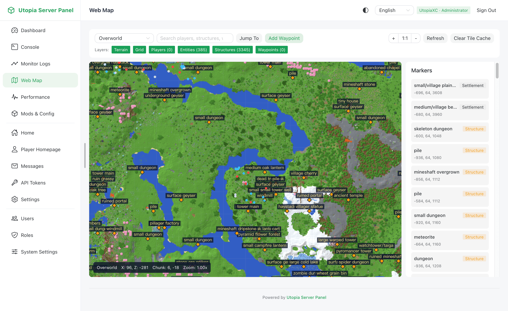

# 小地图

网页小地图允许管理员与玩家直接在浏览器中浏览实时同步的多维度地形地图、在线玩家坐标、实体分布与自定义路径点。

## 核心特性

- **多维度切换**：自动发现主世界、下界、末地及模组新增维度，支持独立视角与缩放浏览。
- **多种渲染模式**：支持从实时已加载区块渲染，也支持从磁盘 `.mca` 区域文件离线读取渲染未加载地形，或使用混合模式按需增量更新。
- **实时叠加层**：支持显示网格线、坐标标尺、水深着色、高度阴影、生物群系染色、在线玩家位置、敌对生物、被动生物、掉落物实体以及结构标记。
- **下界基岩顶层透视**：针对下界维度提供基岩顶层之下地形渲染开关，避免只看到一片基岩。
- **路径点与地图传送**：拥有 `map:2` 权限的用户可以创建和删除路径点；当开启地图传送权限时，点击地图位置即可将绑定的游戏角色传送至目标坐标。

## 联动设置

小地图的所有性能参数与细粒度图层可见性均在 **系统设置 -> 面板功能 -> 网页小地图** 中配置。

### 渲染与缓存参数

| 配置项 | 默认值 | 说明 |
| --- | --- | --- |
| `mapEnabled` | `true` | 网页小地图总开关 |
| `mapRenderMode` | `hybrid` | 渲染模式，支持 `hybrid` 混合渲染、`live` 仅实时区块、`mca` 仅存档区域文件 |
| `mapMaxChunksPerTick` | `2` | 每个服务端 Tick 最多扫描渲染的区块数，范围 `1` 至 `16`，数值越大更新越快但主线程开销越高 |
| `mapCacheMaxMb` | `512` | 地图瓦片磁盘缓存上限，单位为 MB，范围 `32` 至 `16384`，缓存在当前存档目录的 `utopia_server_panel/map_cache` 下 |

具备 `admin:2` 权限的管理员还可在管理操作中清理地图缓存或重置健康度状态。

### 细粒度图层权限映射

面板支持为小地图的 14 项能力单独指定所需的 `map` 权限等级，可选值为只读 `readonly` 或完全控制 `full`：

| 图层或能力 | 默认所需等级 | 说明 |
| --- | --- | --- |
| `mapVisTerrain` | `readonly` | 基础地形瓦片显示 |
| `mapVisNetherCeiling` | `readonly` | 下界基岩顶透视渲染 |
| `mapVisGrid` | `readonly` | 区块网格叠加层 |
| `mapVisCoordinates` | `readonly` | 鼠标悬停坐标显示 |
| `mapVisWaterDepth` | `readonly` | 水深梯度着色 |
| `mapVisHeightShading` | `readonly` | 地形高度差阴影 |
| `mapVisBiomeTint` | `readonly` | 生物群系色彩渲染 |
| `mapVisPlayers` | `readonly` | 在线玩家实时位置标记 |
| `mapVisWaypoints` | `readonly` | 路径点标记显示 |
| `mapVisMobsHostile` | `full` | 敌对生物实时位置 |
| `mapVisMobsPassive` | `full` | 被动生物实时位置 |
| `mapVisEntities` | `full` | 掉落物与其他实体位置 |
| `mapVisStructures` | `full` | 建筑结构标记 |
| `mapVisTeleport` | `full` | 点击地图传送绑定角色 |
