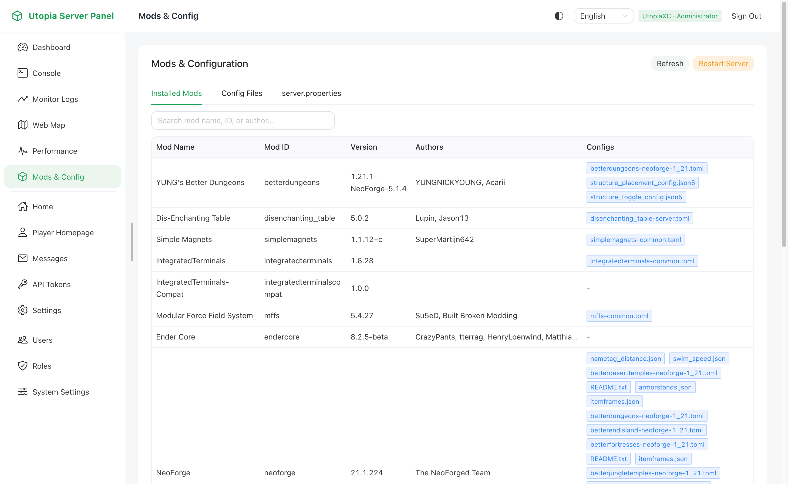

# 模组与服务器配置

模组与服务器配置模块允许在网页端查看服务端已安装的模组列表，并在线浏览或编辑 `server.properties` 与各类模组配置文件。

## 功能概述

- **已安装模组总览**：列出服务端加载的所有模组名称、Mod ID、版本号与简介信息。
- **模组配置文件编辑**：自动扫描 `config/` 目录下的 `.toml`、`.json`、`.properties`、`.cfg` 等文本配置文件，提供在线代码编辑器进行修改与保存。
- **server.properties 管理**：以结构化表单与原始文本形式查看和修改服务器核心配置，例如端口、游戏模式、视距、难度与 MOTD。
- **一键触发重启**：修改关键配置后，可直接在页面点击重启按钮触发服务端重启流程。

## 权限控制

| 权限要求 | 可执行操作 |
| --- | --- |
| `mods_config:1` | 只读查看已安装模组、`config/` 配置文件内容与 `server.properties` |
| `mods_config:2` | 编辑并保存模组配置文件、修改 `server.properties` 以及触发服务端重启 |

## 联动设置

网页端点击「重启服务器」时的具体执行行为，取决于 **系统设置 -> 游戏内联动设置 -> 服务器重启** 中的配置，详见 [游戏内联动设置](/settings/ingame)：

- `serverRestartCommand`：触发重启时向服务端发送的指令，留空时默认执行 `stop` 交由外部进程守护工具拉起。
- `serverRestartHint`：点击重启前向管理员展示的确认提示语，例如提醒外部 Docker 或 systemd 守护方式。
