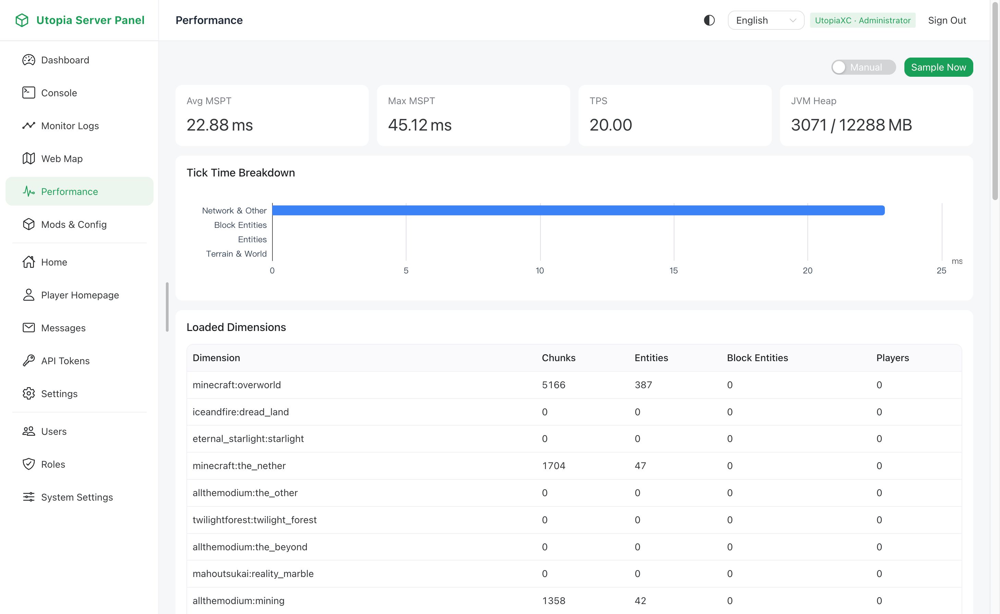

# 性能分析

性能分析模块用于定位造成服务器 TPS 下降或 MSPT 升高的具体维度与区块热点，需要 `profiler` 权限才可访问。

## 功能说明

- **维度热点统计**：汇总各个已加载维度的平均 Tick 耗时、占比以及加载区块数与实体数量。
- **区块热点排行**：列出当前耗时最高的区块坐标、所属维度、实体数量、方块实体数量与估计耗时，帮助管理员快速排查刷怪塔、高频红石或卡服机器。
- **一键传送排查**：具备 `profiler:2` 完全控制权限且已绑定游戏角色的管理员，可以直接点击热点区块的传送按钮，在游戏内将绑定的角色传送至对应坐标进行现场排查。

## 权限对应

| 权限要求 | 可执行操作 |
| --- | --- |
| `profiler:1` | 拉取当前服务器性能热点快照 `/api/profiler/snapshot` |
| `profiler:2` | 执行热点坐标游戏内传送 `/api/profiler/teleport` |
