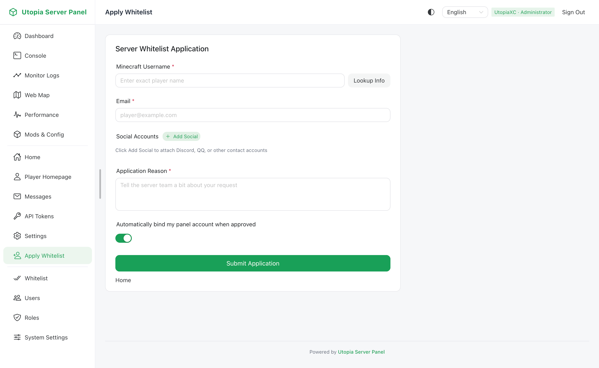
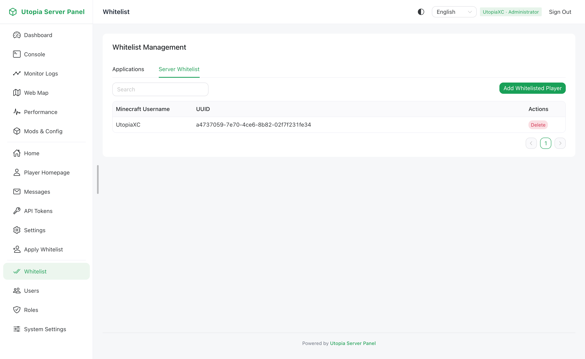

# 白名单管理

Utopia Server Panel 提供了一套从公开申请到后台审核并自动同步服务端白名单的完整流程，无需管理员手动在命令行逐条添加玩家。

## 公开申请流程

当服务器开启白名单管理后，玩家可访问公开白名单页面提交申请：

1. 输入目标 Minecraft 玩家名，系统会自动校验并查询对应玩家状态与当前白名单情况。
2. 填写申请理由或自我介绍；若管理员开启了社交账号必填要求，还需按要求填写对应平台的社交账号信息。
3. 提交后申请进入待审核队列，申请人可随时在同一页面查询审核进度。

## 后台审核与管理

具备 `whitelist_manage` 权限的管理员可在白名单管理页面执行以下操作：

- **审核申请队列**：具备 `whitelist_manage:2` 权限时，可对申请执行「通过」或「拒绝」操作，并可填写审核备注。审核通过后，系统会自动将该玩家加入 Minecraft 服务端原生白名单。
- **手动管理白名单**：直接查看当前服务器白名单列表，支持手动添加或移除玩家名。

## 联动设置

白名单的全部联动开关与风控参数均位于 **系统设置 -> 游戏内联动设置 -> 白名单**：

| 配置项 | 默认值 | 说明 |
| --- | --- | --- |
| `serverWhitelistEnabled` | 与服务端同步 | 直接控制 Minecraft 服务端原生的 `white-list` 开关 |
| `whitelistManagementEnabled` | `false` | 是否启用面板白名单在线申请与审核工作流，关闭原版白名单时会自动关闭该项 |
| `whitelistAllowGuest` | `true` | 是否允许未登录访客提交白名单申请，会同步修改 `guest` 角色的 `whitelist_apply` 权限 |
| `whitelistApplyCooldownSec` | `60` | 同一 IP 提交申请的冷却时间，单位为秒，范围 `0` 至 `86400` |
| `whitelistMaxPendingPerIp` | `5` | 同一 IP 最多允许同时存在的待审核申请数，范围 `1` 至 `50` |
| `whitelistSendEmail` | `false` | 审核通过或拒绝时是否自动向申请人发送结果通知邮件，要求先开启并配置 SMTP |
| `whitelistSocialRequired` | `false` | 是否要求申请人在提交时填写社交账号 |
| `whitelistRequiredSocialPlatforms` | `[]` | 当开启社交账号必填时，指定必须填写的社交平台名称列表 |
