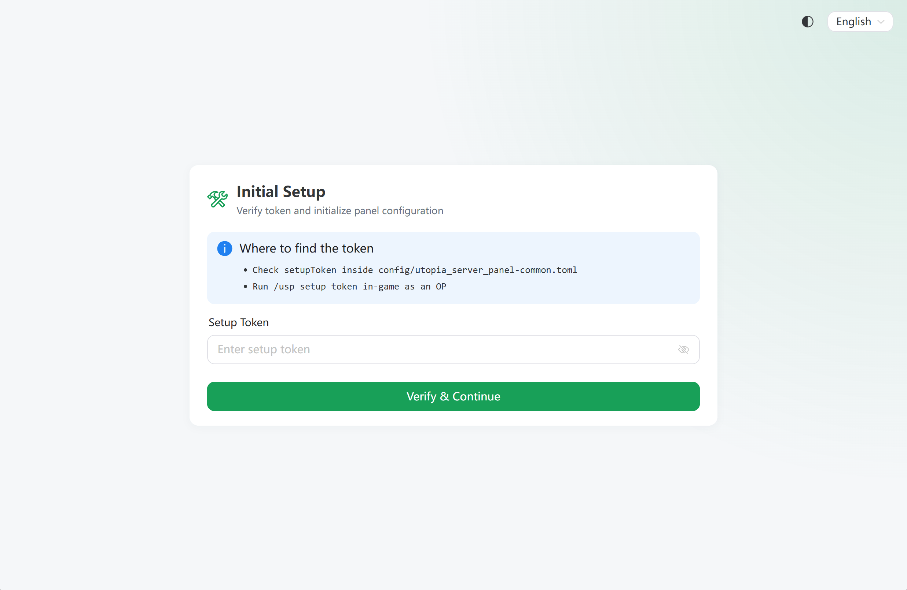

# 快速开始

Utopia Server Panel是一个以Mod形式加载的网页管理面板，因此仅需将对应加载器和版本的本Mod文件放到mods文件夹即可。  

## 安装与初始化

1. 从 [GitHub Releases](https://github.com/UtopiaXC/UtopiaServerPanel/releases)、[CurseForge](https://www.curseforge.com/minecraft/mc-mods/utopia-server-panel) 或 [Modrinth](https://modrinth.com/mod/utopia-server-panel) 下载对应游戏版本与加载器的 `.jar` 文件。
2. 将 `.jar` 放入服务端或本地游戏文件的 `mods/` 目录并启动服务器。
3. 查看配置文件`config/utopia_server_panel.toml`中的setupToken，或在游戏内/后台执行 `/usp setup token` 获取初始化令牌。  
4. 可选：在配置文件中`config/utopia_server_panel.toml`可以修改面板前端的端口号，如有需要可以进行修改，修改后请重启我的世界服务端，默认为```55533```。
5. 在浏览器访问 `http://<服务器IP>:55533`，按引导完成管理员初始化配置。

注：如果你使用可以从CurseForge或Modrinth直接安装模组的启动器如HMCL，请直接在启动其中安装本模组。  



## 兼容矩阵

::: warning 注意
只有 `1.7.10`、`1.12.2`、`1.16.5`、`1.21.1` 和 `26.3` 进行了本地开发环境冒烟测试，如果你希望在其他版本中安装本 mod，请谨慎使用。
:::

| 加载器 | 支持的游戏版本 | 运行环境 |
| --- | --- | --- |
| Forge | `1.7.10`、`1.12.2`、`1.16.5` – `26.3` | Java 8+（1.7.10–1.16.5）、Java 17+（1.18–1.20.4）、Java 21+（1.20.6–1.21.11）、Java 25+（26.x） |
| NeoForge | `1.20.4` – `26.3` | Java 17+（1.20.4）、Java 21+（1.20.6–1.21.11）、Java 25+（26.x） |
| Fabric | `1.16.5` – `26.3` | Java 8+（1.16.5）、Java 17+（1.18–1.20.4）、Java 21+（1.20.6–1.21.11）、Java 25+（26.x） |
